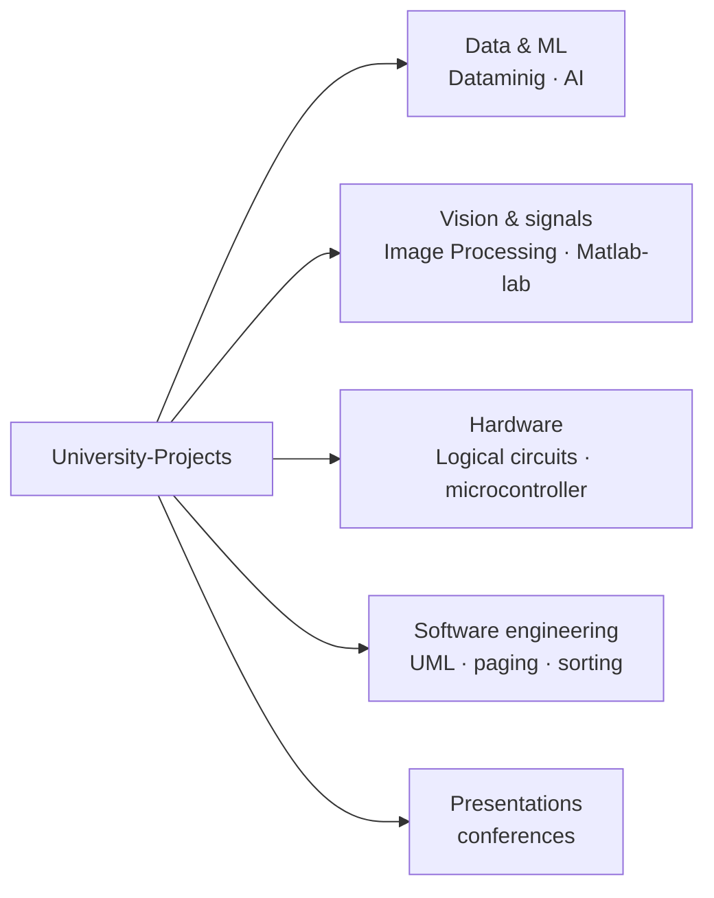

# University-Projects

Coursework from my computer-science degree, organised by topic. Most of the analysis and machine-learning work lives in Jupyter notebooks; older submissions are kept as archives (`.rar`, `.zip`) exactly as they were handed in.

## Topics

| Folder | Contents |
| --- | --- |
| `AI/` | AI fundamentals: local search, particle-swarm optimisation, stemming and lemmatisation in Python |
| `Dataminig/` | Data analysis and model training notebooks (one-hot encoding, normalisation, regression) with practice datasets (`age_salary.csv`, `diamonds.csv`) |
| `Image Processing/` | Computer-vision exercises and projects, including assignment sheets (PDF) and submissions (ZIP) |
| `Logical circuit and architecture/` | Digital design: JK flip-flop, counter with parallel load, plus schematics and reports |
| `Matlab-lab/` | MATLAB exercises: plots, matrix operations, factorial, checkerboard image, filters |
| `Robotics/` | Transformations and robotics fundamentals (transformation matrix in Python) |
| `conferences/` | Talks and slide decks on NLP, swarm robotics, pandas, Active Directory, trading and security |
| `microcontroller/` | Microcontroller assignments (LCD, 7-segment, timer, obstacle game) as archives |
| `paging/` | Paging / memory-management simulation in Python, with a packaged executable |
| `software engineering/` | System analysis and design: UML diagrams and the project document (PDF) |
| `three sort algorithm/` | Benchmark of three sorting algorithms in C++ (Code::Blocks project, explainer video) |

## Structure at a glance

## Running the material

- Notebooks: `pip install jupyter` and then `jupyter notebook`.
- Python scripts: install what the folder needs (`pandas`, `numpy`, `scikit-learn`, `matplotlib`, `nltk`).
- C++ and MATLAB files come from the original courses (Code::Blocks and MATLAB/Octave).

## Notes

Some folders contain compiled artefacts (`.exe`, `.o`) and large media from the original submissions. They are kept for completeness, not as recommended build outputs.
